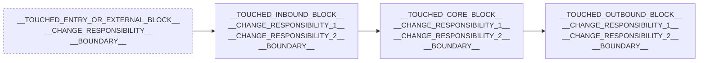

# __WORK_ITEM_ID__ __SYSTEM_OR_CHANGE__

Solution skeleton spec

Sources: `__REQUIREMENTS_PATH__` and `__DESIGN_DECISIONS_PATH__`. `__PLAN_PATH__` waits for human approval only when skeleton review is required (greenfield, or Marvin was explicitly prompted to review this spec). A brownfield plan without that prompt writes the plan in the same turn.

Replace every `__PLACEHOLDER__` with evidence from the requirements and design decisions. Architecture and Building blocks record this change only: the building blocks it touches and the architecture of this change. Do not describe the whole repository. Adapt the diagram to that change; do not force this layout. Remove sections that have no real data. Include every `DD-NNN` record from `design-decisions.md` without creating evidence-only decisions or IDs. Affected plan steps may be proposed until `plan.md` is written.

---

## Architecture

Architecture of this change. Summarize the runtime shape this change adds or alters.

__CONCISE_ARCHITECTURE_OF_THIS_CHANGE__

Arrows are runtime flow for this change.

### Building blocks

Building blocks this change touches. One row per touched block, including an existing project block this change modifies and any block this change adds.

| Building block | Scope | Boundary | Allowed dependencies |
|----------------|-------|----------|----------------------|
| `__TOUCHED_BLOCK_NAME__` | __RESPONSIBILITIES_THIS_CHANGE_OWNS__ | __RESPONSIBILITIES_THIS_CHANGE_EXCLUDES__ | __ALLOWED_DEPENDENCIES_FOR_THIS_CHANGE__ |

---

## Decision record

All planning decisions from `__DESIGN_DECISIONS_PATH__`, including superseded records. IDs and statuses are preserved for verification.

### __EXPLICIT_DECISION_ID__ — __DECISION__

| Field | Recorded value |
|-------|----------------|
| Status | __DECIDED_REQUIRES_ACK_BLOCKED_OR_SUPERSEDED__ |
| Rationale | __RATIONALE__ |
| Evidence | __SOURCE_PATHS_REQUIREMENT_IDS_OR_USER_ANSWER__ |
| Alternatives considered | __ALTERNATIVES_AND_REJECTION_REASONS__ |
| Consequences | __TRADE_OFFS_AND_CONSTRAINTS__ |
| Affected plan steps | __PLAN_STEP_IDS__ |

---

## Risks

**Implementation acknowledgement and risks:** __READINESS_STATUS_AND_ACKNOWLEDGEMENT_RULE__

Carried design risks: __CARRIED_DESIGN_RISK_COUNT__

| ID | Risk | Effect | Mitigation |
|----|------|--------|------------|
| __RISK_ID__ | __RISK_DESCRIPTION__ | __DELIVERY_OR_DESIGN_EFFECT__ | __MITIGATION_OR_REQUIRED_DECISION__ |
